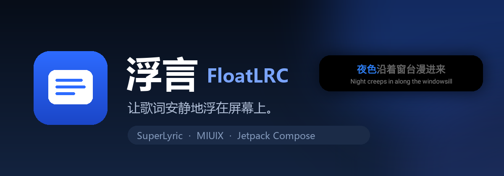
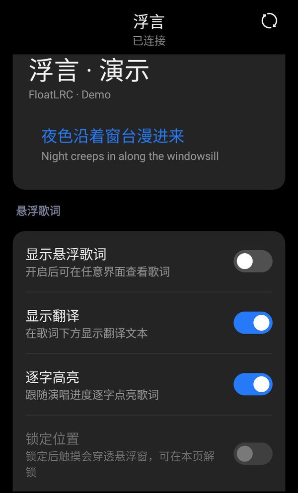
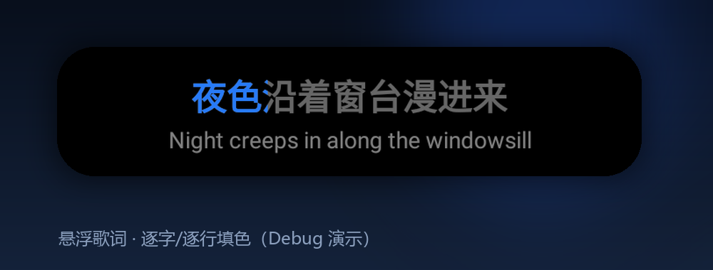
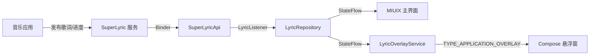

<p align="center">
  
</p>

<p align="center">
  <a href="https://github.com/BlueEve04/FloatLRC/releases/latest"></a>
  
  
  
  
  
</p>

<p align="center">
  <b>让歌词安静地浮在屏幕上。</b><br>
  一个以悬浮窗显示系统级歌词的 Android 应用。
</p>

---

## 简介

浮言（FloatLRC）不播放音乐，也不自行抓取歌词。它通过 [SuperLyric](https://github.com/HChenX/SuperLyric) 的系统级服务接收其他音乐应用正在播放的歌词、翻译和逐字时间，再用一个轻量的悬浮窗显示在任意界面之上。

界面使用 [MIUIX](https://github.com/compose-miuix-ui/miuix) 构建，交互与视觉保持 HyperOS 风格；悬浮窗本身是一个独立的前台服务，切到音乐应用、桌面或其他应用时都能持续显示。

## 功能特性

- **系统级歌词来源**：接收 SuperLyric 发布的歌词，不依赖特定音乐应用。
- **悬浮窗歌词**：当前行 + 翻译，可拖动、可锁定、位置跨进程保留。
- **逐字/逐行填色**：有逐字时间时按字点亮，没有时按整行进度从左到右填充。
- **本地进度插值**：SuperLyric 只在状态变化时推送快照，悬浮窗用 `elapsedRealtime()` 与倍速在本地平滑推进。
- **前台服务**：Android 14+ 使用 `specialUse` 服务类型，配合常驻通知保证悬浮窗存活。
- **MIUIX 设置界面**：开关、滑块、主题切换、权限引导、连接状态一页完成。
- **兼容 3.x / 4.0**：通过 SuperLyricApi 4.0 接入，服务端为 3.x 时自动回退到 legacy 通道。
- **调试演示**：Debug 构建内置不依赖 SuperLyric 的演示歌词，方便预览悬浮窗。

## 截图

<p align="center">
  
</p>

<p align="center">
  
</p>

## 工作原理



- `LyricRepository` 是唯一的接收端入口，主界面与悬浮窗服务通过引用计数共享同一次 Binder 注册。
- 回调可能运行在 Binder 线程；数据会立即转换为不可变的 `NowPlayingUi`，UI 层不持有库对象。
- `position` 是推送时刻的快照。播放中由界面按帧插值；3.x 服务端的 `state` 恒为 `null`，因此按“播放中”处理。
- 悬浮窗服务在 `WindowManager` 中承载一个 `ComposeView`，并手动提供 `Lifecycle`、`SavedStateRegistry` 与 `ViewModelStore`。

## 兼容性

| 项目 | 说明 |
| --- | --- |
| Android | 8.0（API 26）及以上，targetSdk 37 |
| SuperLyric 4.0 | 完整支持，推荐 |
| SuperLyric 3.x | 自动回退到 legacy 通道；不提供播放状态，通常也没有逐字时间 |
| 已实测设备 | FiiO JM21，Android 13，750×1334 |
| 已实测来源 | Poweramp（通过 SuperLyric 3.x legacy 服务） |

> 3.x 服务端下，歌词包通常只有整行时间，因此看到的是**整行**填色；4.0 服务端提供逐字时间时会自动切换到逐字填色。

## 安装与使用

1. 从 [Releases](https://github.com/BlueEve04/FloatLRC/releases/latest) 下载最新 APK 并安装。
2. 确保已安装 [SuperLyric](https://github.com/HChenX/SuperLyric)，并在 LSPosed 中启用其系统服务。
3. 打开浮言，授予“悬浮窗权限”和“通知权限”。
4. 在音乐应用中播放歌曲，主界面连接状态变为“已连接”。
5. 打开“显示悬浮歌词”。

悬浮窗操作：

- **拖动**：按住卡片移动，松手后位置自动保存。
- **点击**：回到浮言主界面。
- **锁定位置**：在设置中开启后，触摸会穿透悬浮窗，避免遮挡底层应用。
- **停止**：关闭主开关，或点击通知中的“停止”。

## 从源码构建

### 环境要求

- JDK 21 或更高版本（本项目在 JDK 25 下构建）
- Android SDK Platform 37、Build-Tools 37.0.0
- Gradle 由仓库内 wrapper 提供（9.8.0）

> MIUIX 0.9.4 的 AAR metadata 要求 `minCompileSdk=37`，因此项目使用 `compileSdk 37`。

```bash
./gradlew :app:assembleDebug
./gradlew :app:assembleRelease
```

产物：

- `app/build/outputs/apk/debug/app-debug.apk`
- `app/build/outputs/apk/release/app-release.apk`

### 签名配置

签名信息从根目录 `local.properties` 读取，该文件已在 `.gitignore` 中忽略：

```properties
sdk.dir=/path/to/Android/Sdk
keyStoreFile=/path/to/keystore.jks
keyStorePassword=******
keyAlias=key_longterm
keyAliasPassword=******
```

缺少完整签名配置时 release APK 不签名。请勿把 `local.properties` 或明文口令提交到仓库。

## 项目结构

```text
app/src/main/java/com/blueeve/floatlrc/
├── FloatLrcApp.kt                 Application，持有设置仓库
├── MainActivity.kt                权限申请、仓库生命周期、Compose 入口
├── data/
│   ├── LyricModels.kt             UI 侧不可变歌词模型与进度插值
│   ├── LyricRepository.kt         SuperLyric 注册、状态流、演示歌词
│   └── AppPreferences.kt          设置与悬浮窗位置持久化
├── overlay/
│   ├── LyricOverlayService.kt     前台服务、WindowManager、通知
│   ├── OverlayLifecycleOwner.kt   ComposeView 的生命周期宿主
│   └── OverlayLyricView.kt        悬浮窗 UI 与逐字/逐行填色
└── ui/
    ├── Theme.kt                   MiuixTheme 封装
    ├── MainScreen.kt              MIUIX 主界面
    └── MainViewModel.kt           组合仓库、设置与服务状态
```

## 权限说明

| 权限 | 用途 |
| --- | --- |
| `SYSTEM_ALERT_WINDOW` | 显示悬浮窗 |
| `FOREGROUND_SERVICE` | 保持悬浮窗服务存活 |
| `FOREGROUND_SERVICE_SPECIAL_USE` | Android 14+ 的悬浮窗前台服务类型 |
| `POST_NOTIFICATIONS` | 显示常驻通知与停止入口 |

应用不请求网络、存储或读取媒体库的权限；歌词完全来自 SuperLyric 提供的 Binder 数据。

## 已知限制

- **3.x 没有暂停状态**：服务端不提供 `state`，暂停后本地插值仍会前进，直到下一帧将其拉回。
- **3.x 通常没有逐字时间**：这种情况下只能做整行填色。4.0 的逐字路径已经实现，但尚未在 4.0 服务端上实机验证时间语义。
- 暂不支持多行歌词滚动、通知栏播放控制、开机自启。
- MIUIX 仍处于实验阶段，升级版本时可能需要适配 API 变化。
- 不同 ROM 对后台前台服务、悬浮窗权限的额外限制可能影响常驻表现。

## Roadmap

- [ ] 在 SuperLyric 4.0 服务端验证逐字时间语义
- [ ] 多行歌词与上下句滚动
- [ ] 通知栏播放控制与锁屏歌词
- [ ] 开机自启与服务恢复策略
- [ ] 更细粒度的字体、颜色、宽高自定义
- [ ] 单元测试与 Compose 截图测试

## 第三方与致谢

- [SuperLyric](https://github.com/HChenX/SuperLyric) / [SuperLyricApi](https://github.com/HChenX/SuperLyricApi)，作者 HChenX，LGPL-2.1。
- [MIUIX](https://github.com/compose-miuix-ui/miuix)，Apache-2.0。
- [Jetpack Compose](https://developer.android.com/jetpack/compose) 与 AndroidX，Apache-2.0。

详细许可见 [THIRD_PARTY_NOTICES.md](THIRD_PARTY_NOTICES.md)。

## 许可证

本项目以 **GNU General Public License v3.0** 发布，详见 [LICENSE](LICENSE)。

## 免责声明

本项目与小米、HyperOS、MIUIX、SuperLyric、FiiO 等第三方均无隶属关系。歌词内容的版权归各自权利人所有；浮言只负责显示由 SuperLyric 提供的数据。请自行确认在所在地区的使用方式符合相关规定。

---

## English Summary

FloatLRC is an Android app that renders system-wide lyrics in a floating overlay. It consumes lyrics from [SuperLyric](https://github.com/HChenX/SuperLyric) through [SuperLyricApi](https://github.com/HChenX/SuperLyricApi), and uses [MIUIX](https://github.com/compose-miuix-ui/miuix) for its Compose UI. The overlay supports per-word or per-line karaoke fill, translation, dragging, position locking, and a foreground service. Requires Android 8.0+ and an active SuperLyric service.
